# imgs/image-Handling-and-Pixel-Transformations-Using-OpenCV
## AIM:
Write a Python program using OpenCV that performs the following tasks:

Read and Display an Image.
Adjust the brightness of an image.
Modify the image contrast.
Generate a third image using bitwise operations.


## Software Required:
Anaconda - Python 3.7
Jupyter Notebook (for interactive development and execution)

## Algorithm:
### Step 1:
Load an image from your local directory and display it.

### Step 2:
Create a matrix of ones (with data type float64) to adjust brightness.

### Step 3:
Create brighter and darker images by adding and subtracting the matrix from the original image.
Display the original, brighter, and darker images.

### Step 4:
Modify the image contrast by creating two higher contrast images using scaling factors of 1.1 and 1.2 (without overflow fix).
Display the original, lower contrast, and higher contrast images.

### Step 5:
Split the image (boy.jpg) into B, G, R components and display the channels

### Program Developed By:
### Name: [BALASUBRAMANIAM L]

## Register Number: [21224240020]


# OpenCV Image Processing

## Step 1: Read and Display an Image

```python
import cv2
import matplotlib.pyplot as plt

# Read the image using OpenCV
img = cv2.imread('varshan.jpeg', cv2.IMREAD_COLOR)

# Convert BGR (OpenCV's default) to RGB (Matplotlib's expected color order)
img_rgb = cv2.cvtColor(img, cv2.COLOR_BGR2RGB)

# Display the image
plt.imshow(img_rgb)
plt.title("Original Image")
plt.axis('off')
plt.show()
```

## Step 2: Draw Shapes and Add Text

### 2.1 Draw a Line

```python
# Load the image
image = cv2.imread('varshan.jpeg')

# Convert BGR to RGB
img_rgb = cv2.cvtColor(image, cv2.COLOR_BGR2RGB)

# Check image dimensions
print(img_rgb.shape)

# Draw a line from top-left to bottom-right
line_img = cv2.line(img_rgb, (0, 0), (768, 600), (255, 0, 0), 2)

# cv2.line(image, start_point, end_point, color, thickness)

# Display the image
plt.imshow(line_img)
plt.title("Image with Line")
plt.axis('off')
plt.show()
```

### 2.2 Draw a Circle

```python
# Load the image
image = cv2.imread('varshan.jpeg')

# Convert BGR to RGB
img_rgb = cv2.cvtColor(image, cv2.COLOR_BGR2RGB)

# Check image dimensions
print(img_rgb.shape)

# Draw a circle
circle_img = cv2.circle(img_rgb, (400, 300), 150, (255, 0, 0), 10)

# cv2.circle(image, center, radius, color, thickness)

# Display the image
plt.imshow(circle_img)
plt.title("Image with Circle")
plt.axis('off')
plt.show()
```

### 2.3 Draw a Rectangle

```python
# Load the image
image = cv2.imread('Qno. 1.jpg')

# Convert BGR to RGB
img_rgb = cv2.cvtColor(image, cv2.COLOR_BGR2RGB)

# Check image dimensions
print(image.shape)

# Draw a rectangle around the image
rectangle_img = cv2.rectangle(img_rgb, (0, 0), (768, 600), (0, 0, 255), 10)

# cv2.rectangle(image, start_point, end_point, color, thickness)

# Display the image
plt.imshow(rectangle_img)
plt.title("Image with Rectangle")
plt.axis('off')
plt.show()
```

### 2.4 Add Text to the Image

```python
# Load the image
image = cv2.imread('Qno. 1.jpg')

# Convert BGR to RGB
img_rgb = cv2.cvtColor(image, cv2.COLOR_BGR2RGB)

# Add text to the image
text_img = cv2.putText(
    img_rgb,
    "OpenCV Drawing",
    (10, 30),
    cv2.FONT_HERSHEY_SIMPLEX,
    1,
    (255, 255, 255),
    10
)

# cv2.putText(image, text, position, font, font_scale, color, thickness)

# Display the image
plt.imshow(text_img)
plt.title("Image with Text")
plt.axis('off')
plt.show()
```

## Step 3: Color Space Conversion

```python
# Load the image
image = cv2.imread('varshan.jpeg')

# Convert BGR to RGB
image_rgb = cv2.cvtColor(image, cv2.COLOR_BGR2RGB)

# Display the original RGB image
plt.imshow(image_rgb)
plt.title("Original RGB Image")
plt.axis("off")
plt.show()

# Convert RGB to HSV
image_hsv = cv2.cvtColor(image_rgb, cv2.COLOR_RGB2HSV)

# Display the HSV image
plt.imshow(image_hsv)
plt.title("HSV Image")
plt.axis("off")
plt.show()

# Convert RGB to Grayscale
image_gray = cv2.cvtColor(image_rgb, cv2.COLOR_RGB2GRAY)

# Display the grayscale image
plt.imshow(image_gray, cmap='gray')
plt.title("Grayscale Image")
plt.axis("off")
plt.show()

# Convert RGB to YCrCb
image_ycrcb = cv2.cvtColor(image_rgb, cv2.COLOR_RGB2YCrCb)

# Display the YCrCb image
plt.imshow(image_ycrcb)
plt.title("YCrCb Image")
plt.axis("off")
plt.show()

# Convert HSV back to RGB
image_hsv_to_rgb = cv2.cvtColor(image_hsv, cv2.COLOR_HSV2RGB)

# Display the converted image
plt.imshow(image_hsv_to_rgb)
plt.title("HSV to RGB Image")
plt.axis("off")
plt.show()
```

## Step 4: Pixel Manipulation

```python
# Modify a 300x300 block of pixels to white, starting at (200, 200)
image[200:500, 200:500] = [255, 255, 255]

# Rows: 200-499, Columns: 200-499

# Convert BGR to RGB for displaying with Matplotlib
image_rgb = cv2.cvtColor(image, cv2.COLOR_BGR2RGB)

# Display the modified image
plt.imshow(image_rgb)
plt.title("Image with 300x300 White Block")
plt.axis("off")
plt.show()
```

## Step 5: Image Resizing

```python
# Load the image
image = cv2.imread('varshan.jpeg')

# Check the original image dimensions
print(image.shape)

# Resize the image to half its size
resized_image = cv2.resize(image, (768 // 2, 600 // 2))

# Dimensions are specified as (new_width, new_height)

# Convert BGR to RGB for displaying with Matplotlib
resized_image_rgb = cv2.cvtColor(resized_image, cv2.COLOR_BGR2RGB)

# Check the resized image dimensions
print(resized_image_rgb.shape)

# Display the resized image
plt.imshow(resized_image_rgb)
plt.title("Resized Image (Half Size)")
plt.axis("off")
plt.show()
```

## Step 6: Image Cropping

```python
# Load the image
image = cv2.imread('varshan.jpeg')

# Check image dimensions
print(image.shape)

# Crop a 300x300 region starting from (50, 50)
roi = image[50:350, 50:350]

# Rows: 50-349, Columns: 50-349

# Convert BGR to RGB for displaying with Matplotlib
roi_rgb = cv2.cvtColor(roi, cv2.COLOR_BGR2RGB)

# Display the cropped region (ROI)
plt.imshow(roi_rgb)
plt.title("Cropped Region of Interest (ROI)")
plt.axis("off")
plt.show()
```

## Step 7: Image Flipping

```python
# Load the image
image = cv2.imread('varshan.jpeg')

# Flip the image horizontally (left to right)
flipped_horizontally = cv2.flip(image, 1)

# Convert BGR to RGB for displaying with Matplotlib
flipped_horizontally_rgb = cv2.cvtColor(
    flipped_horizontally, cv2.COLOR_BGR2RGB
)

# Display the horizontally flipped image
plt.imshow(flipped_horizontally_rgb)
plt.title("Flipped Horizontally")
plt.axis("off")
plt.show()

# Flip the image vertically (top to bottom)
flipped_vertically = cv2.flip(image, 0)

# Convert BGR to RGB for displaying with Matplotlib
flipped_vertically_rgb = cv2.cvtColor(
    flipped_vertically, cv2.COLOR_BGR2RGB
)

# Display the vertically flipped image
plt.imshow(flipped_vertically_rgb)
plt.title("Flipped Vertically")
plt.axis("off")
plt.show()
```
## Output:

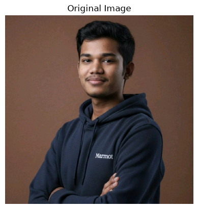
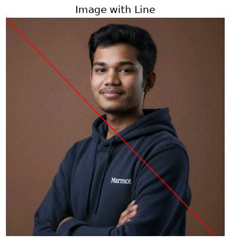
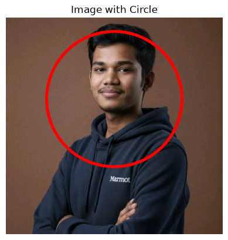
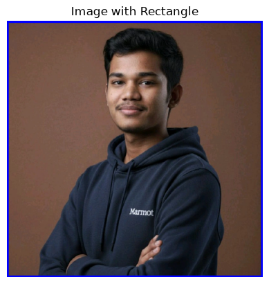
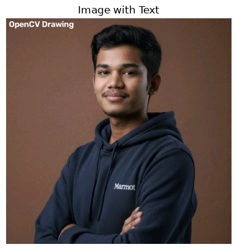

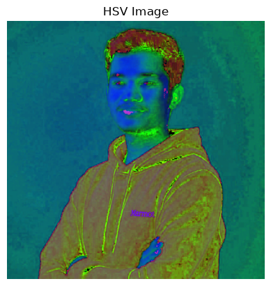
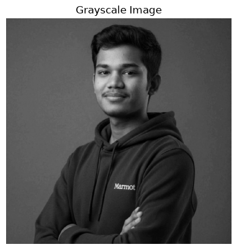
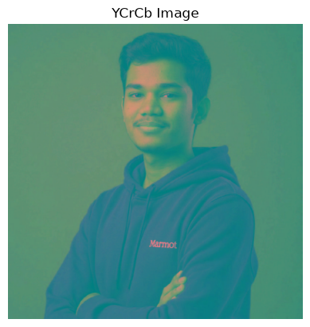
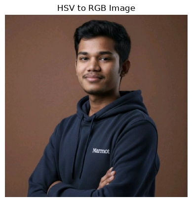
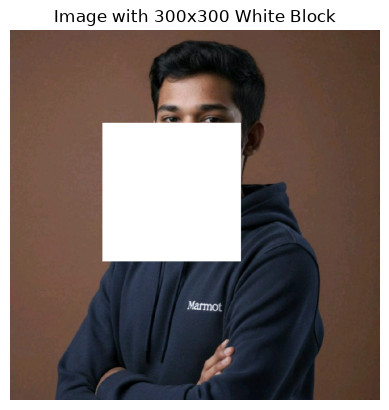
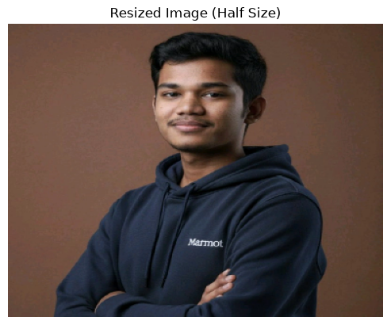
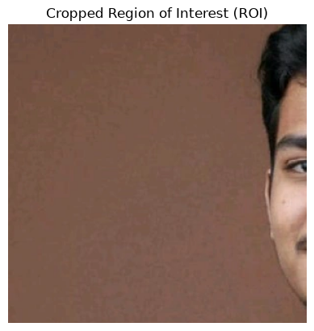
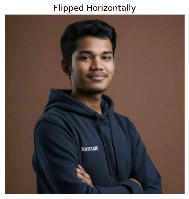
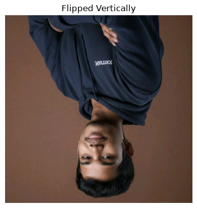

## Result:
Thus, the images were read, displayed, brightness and contrast adjustments were made, and bitwise operations were performed successfully using the Python program.
