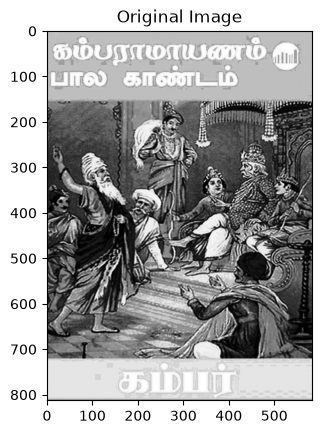
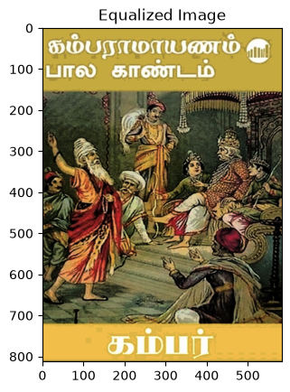
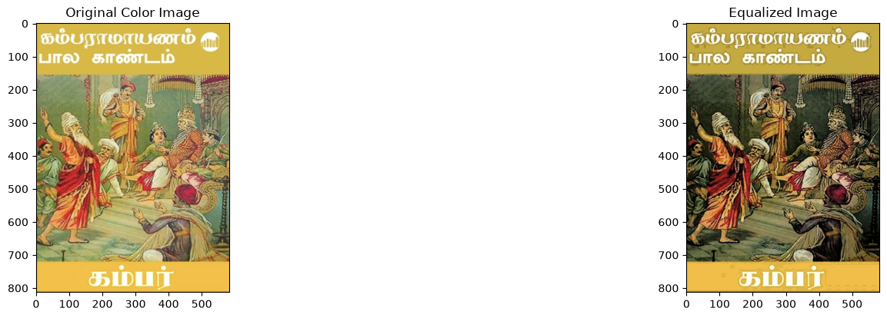
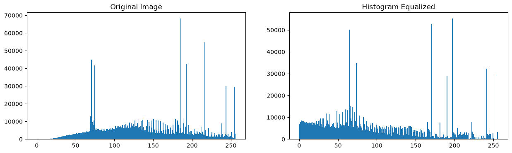

# Histogram Equalization Using OpenCV (Grayscale & Color Images)

## Aim

To implement histogram equalization using OpenCV in Python for both grayscale and color images to improve image contrast and brightness.

The program performs the following operations:

- Read and display a grayscale image.
- Plot the histogram of the grayscale image.
- Apply histogram equalization to the grayscale image.
- Read and display a color image.
- Plot histograms of the Blue, Green, and Red (BGR) channels.
- Convert the color image into HSV color space.
- Apply histogram equalization to the Value (V) channel.
- Convert the enhanced image back to BGR format.
- Display original and enhanced images along with their histograms.

---

## Software Requirements

| Software / Library | Description |
|---|---|
| Anaconda | Python 3.7 Environment |
| Jupyter Notebook / VS Code | Development Environment |
| OpenCV (`cv2`) | Image Processing |
| NumPy | Numerical Operations |
| Matplotlib | Image Visualization and Histogram Plotting |

---

## Algorithm

**Step 1:** Import the required libraries: OpenCV, NumPy, and Matplotlib.

**Step 2:** Read the input image `parrot.jpg` in grayscale format.

**Step 3:** Display the original grayscale image and plot its histogram.

**Step 4:** Apply histogram equalization using `cv2.equalizeHist()` to improve image contrast.

**Step 5:** Display the original grayscale image, its histogram, the equalized image, and its histogram using a 2 × 2 grid.

**Step 6:** Read the same image in color format.

**Step 7:** Split the color image into Blue, Green, and Red (BGR) channels and plot their histograms.

**Step 8:** Convert the image from BGR to HSV color space.

**Step 9:** Separate the HSV channels and apply histogram equalization to the Value (V) channel.

**Step 10:** Merge the HSV channels and convert the enhanced image back to BGR format.

**Step 11:** Display the original color image, its histogram, the enhanced color image, and its histogram using a 2 × 2 grid.

---

## Program

```python
import cv2
import numpy as np
import matplotlib.pyplot as plt

# Step 1: Read the image in grayscale
gray = cv2.imread("image.jpg", cv2.IMREAD_GRAYSCALE)

if gray is None:
    print("Error: image.jpg not found!")
    exit()

# Step 2: Apply histogram equalization
equalized_gray = cv2.equalizeHist(gray)

# Step 3: Display grayscale images and histograms
plt.figure(figsize=(10, 8))

plt.subplot(2, 2, 1)
plt.imshow(gray, cmap="gray")
plt.title("Original Grayscale Image")
plt.axis("off")

plt.subplot(2, 2, 2)
plt.hist(gray.ravel(), 256, [0, 256], color="black")
plt.title("Original Grayscale Histogram")

plt.subplot(2, 2, 3)
plt.imshow(equalized_gray, cmap="gray")
plt.title("Equalized Grayscale Image")
plt.axis("off")

plt.subplot(2, 2, 4)
plt.hist(equalized_gray.ravel(), 256, [0, 256], color="black")
plt.title("Equalized Grayscale Histogram")

plt.tight_layout()
plt.show()

# Step 4: Read the image in color
color = cv2.imread("parrot.jpg")

if color is None:
    print("Error: Cannot read color image!")
    exit()

# Step 5: Split B, G, R channels
b, g, r = cv2.split(color)

# Step 6: Convert BGR to HSV
hsv = cv2.cvtColor(color, cv2.COLOR_BGR2HSV)

# Step 7: Apply histogram equalization to V channel
h, s, v = cv2.split(hsv)
equalized_v = cv2.equalizeHist(v)

# Step 8: Merge HSV channels
enhanced_hsv = cv2.merge((h, s, equalized_v))

# Step 9: Convert HSV back to BGR
enhanced_color = cv2.cvtColor(
    enhanced_hsv, cv2.COLOR_HSV2BGR
)

# Step 10: Display original color image and histogram
plt.figure(figsize=(12, 8))

plt.subplot(2, 2, 1)
plt.imshow(cv2.cvtColor(color, cv2.COLOR_BGR2RGB))
plt.title("Original Color Image")
plt.axis("off")

plt.subplot(2, 2, 2)
plt.hist(b.ravel(), 256, [0, 256],
         color="blue", alpha=0.5, label="Blue")
plt.hist(g.ravel(), 256, [0, 256],
         color="green", alpha=0.5, label="Green")
plt.hist(r.ravel(), 256, [0, 256],
         color="red", alpha=0.5, label="Red")
plt.title("Original BGR Histogram")
plt.legend()

# Step 11: Display enhanced color image
plt.subplot(2, 2, 3)
plt.imshow(cv2.cvtColor(enhanced_color, cv2.COLOR_BGR2RGB))
plt.title("Enhanced Color Image")
plt.axis("off")

# Step 12: Plot enhanced color histogram
eb, eg, er = cv2.split(enhanced_color)

plt.subplot(2, 2, 4)
plt.hist(eb.ravel(), 256, [0, 256],
         color="blue", alpha=0.5, label="Blue")
plt.hist(eg.ravel(), 256, [0, 256],
         color="green", alpha=0.5, label="Green")
plt.hist(er.ravel(), 256, [0, 256],
         color="red", alpha=0.5, label="Red")
plt.title("Enhanced BGR Histogram")
plt.legend()

plt.tight_layout()
plt.show()

print("Histogram equalization completed successfully!")
```

---

## Output

### Grayscale Histogram Equalization



The output displays:

- Original grayscale image.
- Histogram of the original grayscale image.
- Equalized grayscale image.
- Histogram of the equalized grayscale image.

### Color Image Histogram Equalization


---





## Result

Thus, histogram equalization was successfully implemented on both grayscale and color images using OpenCV. The technique improves image contrast by redistributing intensity values, resulting in better visual quality and feature visibility.

---

## Developed By

| Details | Information |
|---|---|
| **Name** | BALASUBRAMANIAM L |
| **Register Number** | 212224240020 |

---

## Repository Structure

```text
Histogram-Equalization-Using-OpenCV/
│
├── image.png
├── histogram_equalization.py
└── README.md
```

## References

- [OpenCV Documentation](https://docs.opencv.org/)
- [NumPy Documentation](https://numpy.org/doc/)
- [Matplotlib Documentation](https://matplotlib.org/stable/contents.html)