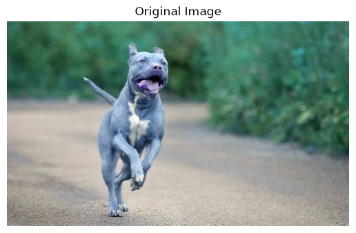
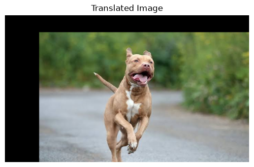
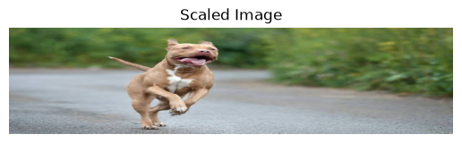
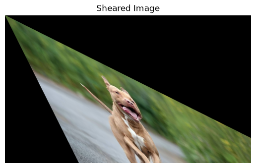
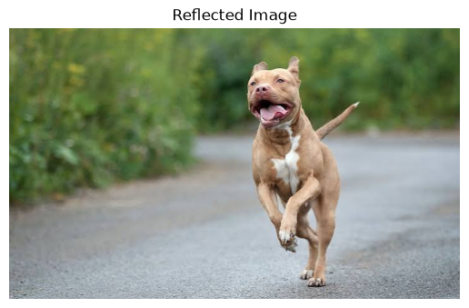
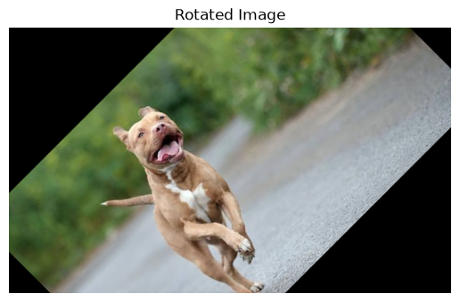
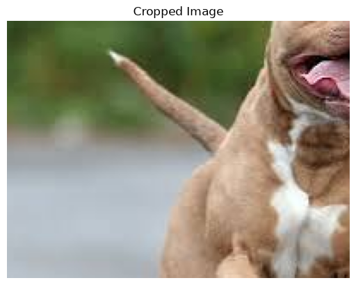

# Geometric Transformations Using OpenCV

A Python-based computer vision project demonstrating fundamental geometric image transformations using **OpenCV, NumPy, and Matplotlib**.

## Overview

This project demonstrates how digital images can be spatially manipulated using OpenCV. It implements various geometric transformations to modify an image's position, dimensions, orientation, and shape.

## Features

The project implements the following image transformations:

| Transformation | Description |
|---|---|
| Translation | Shifts an image horizontally and vertically |
| Scaling | Resizes an image by increasing or decreasing its dimensions |
| Shearing | Slants an image along horizontal and vertical axes |
| Reflection | Flips an image horizontally, vertically, or along both axes |
| Rotation | Rotates an image around its center |
| Cropping | Extracts a specific region from an image |

## Tech Stack

- **Programming Language:** Python 3.7
- **Computer Vision:** OpenCV (`cv2`)
- **Numerical Processing:** NumPy
- **Visualization:** Matplotlib
- **Development Environment:** Jupyter Notebook / VS Code

## Project Structure

```text
Geometric-Transformations-OpenCV/
│
├── spider.png
├── geometric_transformations.ipynb
└── README.md
```

## Installation

### 1. Clone the Repository

```bash
git clone <YOUR_REPOSITORY_URL>
cd Geometric-Transformations-OpenCV
```

### 2. Install Dependencies

```bash
pip install opencv-python numpy matplotlib
```

### 3. Run the Project

Open the Jupyter Notebook:

```bash
jupyter notebook
```

Run `geometric_transformations.ipynb` and execute the cells sequentially.

## Implementation

### 1. Image Translation

Moves an image along the X and Y axes using a translation matrix and `cv2.warpAffine()`.

### 2. Image Scaling

Changes image dimensions using `cv2.resize()` with interpolation techniques.

### 3. Image Shearing

Applies horizontal and vertical shearing using transformation matrices.

### 4. Image Reflection

Uses `cv2.flip()` to perform image flipping along different axes.

### 5. Image Rotation

Rotates an image using `cv2.getRotationMatrix2D()` and `cv2.warpAffine()`.

### 6. Image Cropping

Extracts a selected region of an image using NumPy array slicing.

## Results

The project successfully demonstrates the following transformations:

- Original and translated images


- Scaled images

- Horizontally and vertically sheared images

- Reflected images

- Rotated images

- Cropped image regions


## Learning Outcomes

Through this implementation, the following concepts are explored:

- Understanding geometric transformations in computer vision.
- Working with image coordinate systems.
- Applying affine transformation matrices.
- Manipulating image dimensions and orientations.
- Visualizing image processing operations using Matplotlib.

## Author

**BALASUBRAMANIAM L P**

- Register Number: 21222424002
