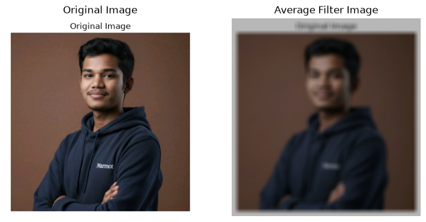
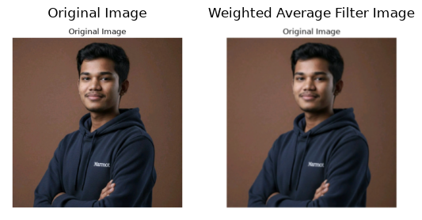
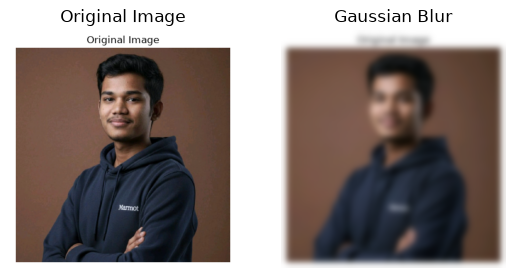
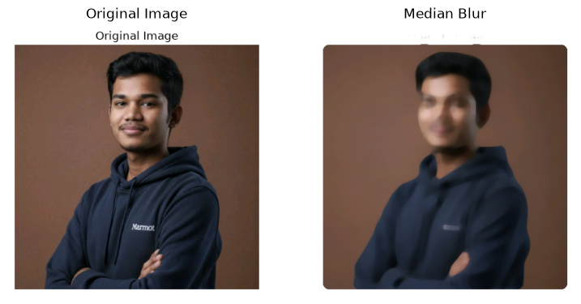
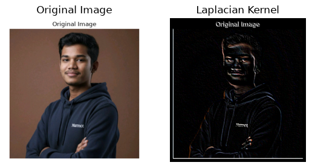
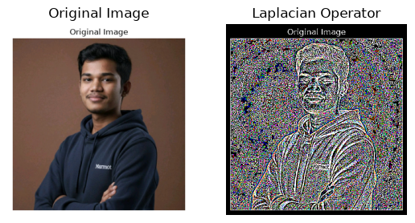

# Image Smoothing and Sharpening Using OpenCV

## Aim

To implement different smoothing and sharpening filters using OpenCV in Python for image enhancement.

The program applies four smoothing filters (Averaging, Weighted Averaging, Gaussian, and Median) and two sharpening techniques (Laplacian Kernel and Laplacian Operator) to improve image quality and enhance edges.

## Operations Performed

- Read and display an input image.
- Apply Averaging Filter.
- Apply Weighted Averaging Filter.
- Apply Gaussian Filter.
- Apply Median Filter.
- Apply Laplacian Sharpening using a custom kernel.
- Apply Laplacian Operator.
- Display the original and processed images for comparison.

---

## Software Requirements

| Software / Library | Description |
|---|---|
| Anaconda | Python 3.7 Environment |
| Jupyter Notebook / VS Code | Development Environment |
| OpenCV (`cv2`) | Image Processing |
| NumPy | Numerical Operations |
| Matplotlib | Image Visualization |

---

## Algorithm

**Step 1:** Import the required libraries: OpenCV, NumPy, and Matplotlib.

**Step 2:** Read the input image (e.g., `image.jpeg`).

**Step 3:** Convert the image from BGR to RGB format for proper visualization.

**Step 4:** Apply the Averaging Filter using `cv2.filter2D()` with a normalized averaging kernel.

**Step 5:** Apply the Weighted Averaging Filter using a custom kernel with `cv2.filter2D()`.

**Step 6:** Apply the Gaussian Filter using `cv2.GaussianBlur()`.

**Step 7:** Apply the Median Filter using `cv2.medianBlur()`.

**Step 8:** Apply Laplacian Sharpening using a custom kernel with `cv2.filter2D()`.

**Step 9:** Convert the image into grayscale and apply the Laplacian Operator using `cv2.Laplacian()`.

**Step 10:** Display the original image and all processed images for comparison.

---

## Developed By

| Details | Information |
|---|---|
| **Name** | BALASUBRAMANIAM L |
| **Register Number** | 212224240020 |

---

## Program

### 1. Smoothing Filters

#### Averaging Filter

```python
import cv2
import matplotlib.pyplot as plt
import numpy as np

image1 = cv2.imread("image.jpeg")
image2 = cv2.cvtColor(image1, cv2.COLOR_BGR2RGB)

kernel = np.ones((11, 11), np.float32) / 169
image3 = cv2.filter2D(image2, -1, kernel)

plt.figure(figsize=(9, 9))

plt.subplot(1, 2, 1)
plt.imshow(image2)
plt.title("Original Image")
plt.axis("off")

plt.subplot(1, 2, 2)
plt.imshow(image3)
plt.title("Average Filter Image")
plt.axis("off")

plt.show()
```

#### Weighted Averaging Filter

```python
kernel1 = np.array([
    [1, 2, 1],
    [2, 4, 2],
    [1, 2, 1]
]) / 16

image3 = cv2.filter2D(image2, -1, kernel1)

plt.imshow(image3)
plt.title("Weighted Average Filter Image")
plt.axis("off")
plt.show()
```

#### Gaussian Filter

```python
gaussian_blur = cv2.GaussianBlur(
    image2, (33, 33), 0, 0
)

plt.imshow(gaussian_blur)
plt.title("Gaussian Blur")
plt.axis("off")
plt.show()
```

#### Median Filter

```python
median = cv2.medianBlur(image2, 13)

plt.imshow(median)
plt.title("Median Blur")
plt.axis("off")
plt.show()
```

### 2. Sharpening Filters

#### Laplacian Kernel

```python
kernel2 = np.array([
    [-1, -1, -1],
    [ 2, -2,  1],
    [ 2,  1, -1]
])

image3 = cv2.filter2D(image2, -1, kernel2)

plt.imshow(image3)
plt.title("Laplacian Kernel")
plt.axis("off")
plt.show()
```

#### Laplacian Operator

```python
laplacian = cv2.Laplacian(
    image2, cv2.CV_64F
)

plt.imshow(laplacian)
plt.title("Laplacian Operator")
plt.axis("off")
plt.show()
```

---

## Output

### Smoothing Filters

**1. Averaging Filter**

Produces a blurred image by replacing each pixel with the average intensity of its neighboring pixels.



**2. Weighted Averaging Filter**

Applies greater importance to central pixels, producing a smoother result.



**3. Gaussian Filter**

Reduces image noise using a Gaussian-weighted kernel while providing smoother transitions.



**4. Median Filter**

Removes salt-and-pepper noise effectively by replacing each pixel with the median value of its neighborhood.



### Sharpening Filters

**5. Laplacian Kernel**

Enhances edges and fine image details using a custom Laplacian kernel.



**6. Laplacian Operator**

Detects rapid intensity changes and highlights image edges using the Laplacian operator.



---

## Result

Thus, different smoothing and sharpening filters were successfully implemented using OpenCV.

The smoothing filters reduce noise and unwanted details, while the sharpening filters enhance edges and image details. These techniques improve image quality and support further image processing and feature extraction tasks.

---

## References

- [OpenCV Documentation](https://docs.opencv.org/)
- [NumPy Documentation](https://numpy.org/doc/)
- [Matplotlib Documentation](https://matplotlib.org/stable/contents.html)

---