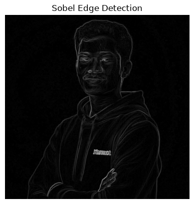
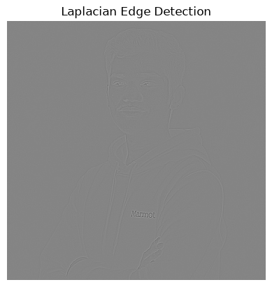
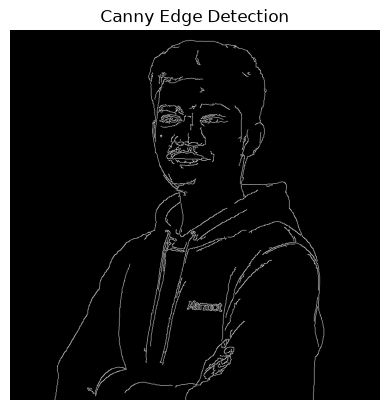

# edge-detection-opencv

## Aim

To perform edge detection using Sobel, Roberts, Prewitt, Laplacian, and Canny edge detectors.

---

## Software Required

- Anaconda – Python 3.7
- Jupyter Notebook / VS Code
- OpenCV (cv2)
- NumPy
- Matplotlib

---

## Algorithm

### Step 1:
Import all the necessary modules for the program.

### Step 2:
Load an image using `cv2.imread()`.

### Step 3:
Convert the image to grayscale.

### Step 4:
Apply **Sobel operator** using OpenCV to detect edges.

### Step 5:
Apply **Prewitt operator** using custom kernels.

### Step 6:
Apply **Roberts operator** using custom kernels.

### Step 7:
Apply **Laplacian operator** using OpenCV.

### Step 8:
Apply **Canny edge detector** using OpenCV.

### Step 9:
Display all edge-detected images for comparison.

---

## Developed By

- **Name:** BALASURAMANIAM L
- **Register No:** 212224240020

---

## Output

### Sobel Edge Detector

- Detects edges in horizontal and vertical directions.
- Produces gradient-based edge map.

### Laplacian Edge Detector

- Detects edges using second-order derivatives.
- Highlights rapid intensity changes.

### Canny Edge Detector

- Multi-stage edge detection.
- Produces clean and thin edges.

---

## Result

Thus, edges are successfully detected using Sobel, Prewitt, Roberts, Laplacian, and Canny edge detection techniques. Each method highlights edges differently based on gradient and intensity variations, improving feature extraction and analysis.